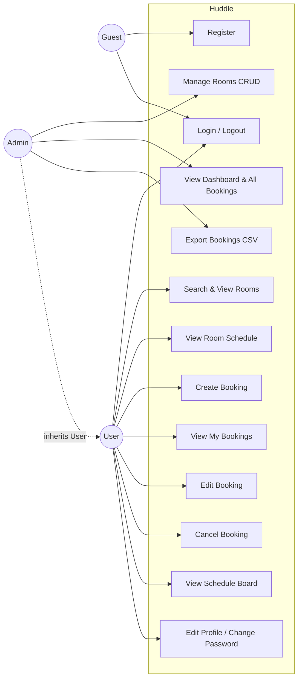
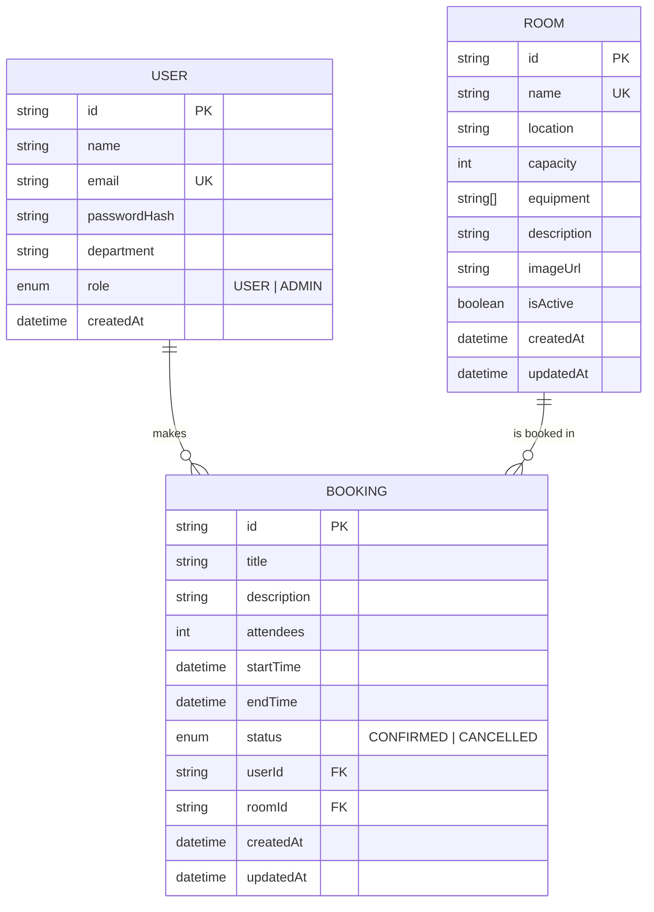
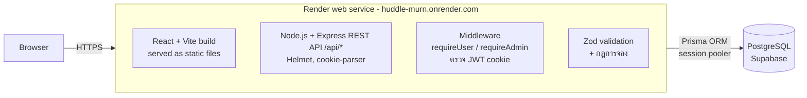
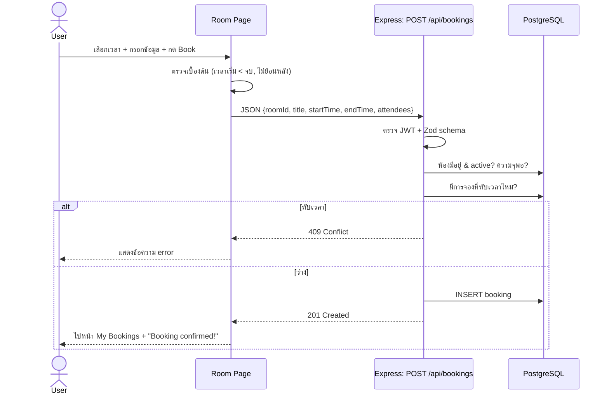

# Software Requirements Specification (SRS)
## Huddle – Meeting Room Booking System

| | |
|---|---|
| เวอร์ชัน | 1.0 |
| วันที่ | 26 ตุลาคม 2026 |
| ผู้จัดทำ | `<ชื่อสมาชิก 1>`, `<ชื่อสมาชิก 2>`, `<ชื่อสมาชิก 3>` |

---

## 1. บทนำ (Introduction)

### 1.1 วัตถุประสงค์
เอกสารนี้กำหนดความต้องการของระบบจองห้องประชุมออนไลน์ (Huddle) เพื่อใช้เป็นแนวทางในการออกแบบ พัฒนา และทดสอบระบบ

### 1.2 ปัญหา (Pain Points)
- องค์กร/คณะจำนวนมากยังจองห้องผ่านกลุ่มแชท สมุด หรือ Excel ทำให้ **จองซ้อน** และมีสองทีมมาใช้ห้องพร้อมกัน
- ไม่รู้ว่าห้องไหน **ว่างเวลาไหน** ต้องถามเจ้าหน้าที่ทุกครั้ง
- ไม่รู้ว่าห้องมี **ความจุ/อุปกรณ์** อะไร
- ผู้ดูแลไม่มีข้อมูล **สถิติการใช้ห้อง** เพื่อวางแผน

### 1.3 ขอบเขตของระบบ (Scope)
เว็บแอปพลิเคชันให้ผู้ใช้ค้นหาห้อง ดูตารางว่าง จอง แก้ไข และยกเลิกการจองได้ด้วยตนเอง ระบบตรวจสอบการจองซ้อนอัตโนมัติ ผู้ดูแลระบบจัดการข้อมูลห้องและดูภาพรวมการจองทั้งหมด
**นอกขอบเขต:** การแจ้งเตือนทางอีเมล, การเชื่อมต่อ Google Calendar, การจองแบบซ้ำ (recurring)

### 1.4 กลุ่มเป้าหมาย / ผู้ใช้งาน
| ผู้ใช้ | คำอธิบาย |
|---|---|
| Guest | ผู้ที่ยังไม่ได้เข้าสู่ระบบ ดูหน้าแรก สมัครสมาชิก และเข้าสู่ระบบได้ |
| User | พนักงาน/นิสิต/อาจารย์ ที่ต้องการจองห้องประชุม |
| Admin | เจ้าหน้าที่ดูแลห้องประชุม |

### 1.5 คำศัพท์
| คำ | ความหมาย |
|---|---|
| Booking | การจองห้อง 1 รายการ มีห้อง วันเวลาเริ่ม-จบ |
| Double booking / Overlap | การจองสองรายการในห้องเดียวกันที่ช่วงเวลาทับกัน |
| CRUD | Create, Read, Update, Delete |

---

## 2. Functional Requirements

### 2.1 การยืนยันตัวตน (Authentication)
| ID | Requirement |
|---|---|
| FR-01 | ผู้ใช้สามารถสมัครสมาชิกด้วย ชื่อ, อีเมล, รหัสผ่าน และแผนก (ไม่บังคับ) |
| FR-02 | ระบบต้องไม่อนุญาตให้สมัครด้วยอีเมลซ้ำ |
| FR-03 | ผู้ใช้สามารถเข้าสู่ระบบด้วยอีเมลและรหัสผ่าน |
| FR-04 | ผู้ใช้สามารถออกจากระบบ |
| FR-05 | ระบบต้องจำกัดสิทธิ์: หน้าที่เกี่ยวกับการจองต้อง login, หน้า Admin เข้าได้เฉพาะ Admin |

### 2.2 ห้องประชุม (Rooms)
| ID | Requirement |
|---|---|
| FR-06 | ผู้ใช้ดูรายการห้องที่เปิดใช้งาน พร้อมสถานที่ ความจุ และอุปกรณ์ |
| FR-07 | ผู้ใช้ค้นหาห้องตามชื่อหรือสถานที่ และกรองตามความจุขั้นต่ำ |
| FR-08 | ผู้ใช้ดูรายละเอียดห้องและตารางการจองรายวัน (08:00–20:00) |
| FR-09 | Admin เพิ่มห้องใหม่ได้ (Create) |
| FR-10 | Admin แก้ไขข้อมูลห้อง และเปิด/ปิดการใช้งานห้องได้ (Update) |
| FR-11 | Admin ลบห้องได้ (Delete) |

### 2.3 การจอง (Bookings)
| ID | Requirement |
|---|---|
| FR-12 | ผู้ใช้จองห้องโดยระบุ ชื่อการประชุม, วันที่, เวลาเริ่ม, เวลาจบ, จำนวนผู้เข้าร่วม, หมายเหตุ |
| FR-13 | ระบบต้องปฏิเสธการจองที่ช่วงเวลาทับกับการจองที่ยืนยันแล้วของห้องเดียวกัน |
| FR-14 | ระบบต้องปฏิเสธการจองย้อนหลัง, เวลาจบก่อนเวลาเริ่ม, ยาวเกิน 8 ชั่วโมง และจำนวนคนเกินความจุห้อง |
| FR-15 | ผู้ใช้ดูรายการการจองของตนเอง แยก Upcoming / Past / Cancelled |
| FR-16 | ผู้ใช้แก้ไขการจองของตนเองที่ยังไม่เริ่ม (เปลี่ยนห้อง/เวลา/รายละเอียด) โดยผ่านการตรวจสอบเดียวกับ FR-13, FR-14 |
| FR-17 | ผู้ใช้ยกเลิกการจองของตนเองได้ (สถานะเป็น CANCELLED และเก็บประวัติไว้) |
| FR-18 | ผู้ใช้ไม่สามารถแก้ไข/ยกเลิกการจองของผู้อื่น |

### 2.4 ผู้ดูแลระบบ (Admin)
| ID | Requirement |
|---|---|
| FR-19 | Admin ดู Dashboard: จำนวนห้อง, ผู้ใช้, การจองที่กำลังจะมาถึง, การจองที่ยกเลิก และจำนวนการจองต่อห้อง |
| FR-20 | Admin ดูการจองทั้งหมด กรองตามห้อง และแก้ไข/ยกเลิกการจองใดก็ได้ |
| FR-21 | Admin ดาวน์โหลดรายการการจอง (ทั้งหมดหรือเฉพาะห้อง) เป็นไฟล์ CSV ที่เปิดด้วย Excel ได้ |

### 2.5 ตารางห้องว่าง (Schedule Board)
| ID | Requirement |
|---|---|
| FR-22 | ผู้ใช้ดูตารางของทุกห้องในวันเดียว แบ่งช่องละ 30 นาที (08:00–20:00) แยกสี ว่าง / ถูกจอง / เลยเวลาแล้ว |
| FR-23 | ผู้ใช้เลื่อนดูวันก่อนหน้า/ถัดไป หรือเลือกวันที่ได้ |
| FR-24 | เมื่อคลิกช่องว่าง ระบบพาไปหน้าจองห้องนั้นพร้อมกรอกวันที่และเวลาเริ่มให้อัตโนมัติ |
| FR-25 | หน้ารายการห้องแสดงสถานะปัจจุบันของแต่ละห้อง (ว่างถึงกี่โมง / ใช้งานอยู่ถึงกี่โมง) |

### 2.6 โปรไฟล์ผู้ใช้ (Profile)
| ID | Requirement |
|---|---|
| FR-26 | ผู้ใช้แก้ไขชื่อและแผนกของตนเองได้ |
| FR-27 | ผู้ใช้เปลี่ยนรหัสผ่านได้ โดยต้องกรอกรหัสผ่านเดิมให้ถูกต้อง และรหัสใหม่ต้องผ่านเงื่อนไขเดียวกับตอนสมัคร |

---

## 3. Non-Functional Requirements

| ID | หมวด | Requirement |
|---|---|---|
| NFR-01 | Security | รหัสผ่านต้องถูก hash ด้วย bcrypt ห้ามเก็บเป็นข้อความธรรมดา |
| NFR-02 | Security | ใช้ JWT เก็บใน httpOnly, SameSite cookie (ป้องกัน XSS อ่าน token) และใช้ HTTPS บน production |
| NFR-03 | Security | ตรวจสอบข้อมูลทุก request ที่ฝั่ง server ด้วย Zod schema และตรวจสิทธิ์ทุก API |
| NFR-04 | Security | ใช้ ORM (Prisma) ป้องกัน SQL Injection |
| NFR-05 | Usability | UI แบบ Responsive รองรับหน้าจอตั้งแต่ 360px (มือถือ) ถึงเดสก์ท็อป |
| NFR-06 | Usability | แสดงข้อความ error ที่เข้าใจง่ายเมื่อกรอกข้อมูลผิดหรือจองไม่สำเร็จ |
| NFR-07 | Performance | หน้าเว็บหลักโหลดเสร็จภายใน 3 วินาทีบนอินเทอร์เน็ตทั่วไป, API ตอบภายใน 1 วินาที |
| NFR-08 | Availability | Deploy บน Render (เว็บ + API) + Supabase (database) ใช้งานได้ 24 ชั่วโมงผ่าน URL สาธารณะ |
| NFR-09 | Maintainability | โค้ดอยู่บน GitHub ใช้ branch / pull request / issue, แยก frontend (client) และ backend (server) ชัดเจน |
| NFR-11 | Security | ใช้ Helmet ตั้ง HTTP security headers และจำกัดขนาด request body |
| NFR-10 | Data Integrity | ใช้ foreign key และ unique constraint (email, ชื่อห้อง) ในฐานข้อมูล |

---

## 4. Use Cases

### 4.1 Use Case Diagram

### 4.2 Use Case Descriptions

**UC5 – Create Booking**
| | |
|---|---|
| Actor | User |
| Precondition | เข้าสู่ระบบแล้ว |
| Main Flow | 1. ผู้ใช้เปิดหน้า Rooms และเลือกห้อง 2. ระบบแสดงรายละเอียดห้องและตารางการจองของวันนี้ 3. ผู้ใช้เลือกวันที่ และคลิกช่วงเวลาที่ว่าง (หรือกรอกเวลาเอง) 4. ผู้ใช้กรอกชื่อการประชุม จำนวนผู้เข้าร่วม แล้วกด Book 5. ระบบตรวจสอบข้อมูลและการจองซ้อน 6. ระบบบันทึกการจอง และพาไปหน้า My Bookings พร้อมข้อความยืนยัน |
| Alternative Flow | 5a. ช่วงเวลาทับการจองอื่น → แสดง "This room is already booked for the selected time" 5b. จำนวนคนเกินความจุ / เวลาไม่ถูกต้อง / ย้อนหลัง → แสดงข้อความ error ที่ตรงกับปัญหา |
| Postcondition | มีการจองสถานะ CONFIRMED ในฐานข้อมูล และช่วงเวลานั้นแสดงเป็น Busy |

**UC7 – Edit Booking**
| | |
|---|---|
| Actor | User (เจ้าของ), Admin |
| Precondition | การจองยังเป็น CONFIRMED และยังไม่ถึงเวลาเริ่ม |
| Main Flow | 1. ผู้ใช้เปิด My Bookings กด Edit 2. แก้ไขห้อง/วัน/เวลา/รายละเอียด กด Save 3. ระบบตรวจสอบเหมือน UC5 (ไม่นับการจองของตัวเอง) และบันทึก |
| Alternative Flow | ผู้ใช้ไม่ใช่เจ้าของ → 403 "You can only manage your own bookings" |

**UC8 – Cancel Booking**
| | |
|---|---|
| Actor | User (เจ้าของ), Admin |
| Main Flow | 1. กด Cancel 2. ยืนยัน 3. ระบบเปลี่ยนสถานะเป็น CANCELLED ช่วงเวลานั้นกลับมาว่าง |

**UC9 – Manage Rooms**
| | |
|---|---|
| Actor | Admin |
| Main Flow | Admin เปิด Manage Rooms → Add / Edit / Delete ห้อง กรอกชื่อ สถานที่ ความจุ อุปกรณ์ สถานะ → ระบบตรวจสอบ (ชื่อไม่ซ้ำ, ความจุ ≥ 1) และบันทึก |

**UC1 – Register / UC2 – Login**
| | |
|---|---|
| Actor | Guest |
| Main Flow | กรอกข้อมูล → ระบบตรวจรูปแบบอีเมล, รหัสผ่าน ≥ 8 ตัว มีตัวอักษรและตัวเลข → สร้างบัญชี/ตรวจรหัสผ่าน → ออก JWT cookie → ไปหน้า Rooms |
| Alternative Flow | อีเมลซ้ำ → 409, รหัสผ่านผิด → 401 "Incorrect email or password" |

---

## 5. Database Design

### 5.1 ER Diagram

### 5.2 Data Dictionary

**User**
| Field | Type | Constraint | คำอธิบาย |
|---|---|---|---|
| id | String (cuid) | PK | รหัสผู้ใช้ |
| name | String | NOT NULL, 2–100 ตัว | ชื่อ |
| email | String | UNIQUE, NOT NULL | อีเมลสำหรับ login |
| passwordHash | String | NOT NULL | รหัสผ่านที่ hash แล้ว |
| department | String | NULL | แผนก |
| role | Enum | default USER | สิทธิ์ USER / ADMIN |
| createdAt | DateTime | default now() | วันที่สมัคร |

**Room**
| Field | Type | Constraint | คำอธิบาย |
|---|---|---|---|
| id | String (cuid) | PK | รหัสห้อง |
| name | String | UNIQUE, NOT NULL | ชื่อห้อง |
| location | String | NOT NULL | อาคาร/ชั้น |
| capacity | Int | 1–500 | จำนวนที่นั่ง |
| equipment | String[] | | อุปกรณ์ เช่น Projector, TV |
| description | String | NULL | รายละเอียด |
| imageUrl | String | NULL, URL | รูปห้อง |
| isActive | Boolean | default true | เปิดให้จองหรือไม่ |

**Booking**
| Field | Type | Constraint | คำอธิบาย |
|---|---|---|---|
| id | String (cuid) | PK | รหัสการจอง |
| title | String | NOT NULL, ≤ 100 | ชื่อการประชุม |
| description | String | NULL | หมายเหตุ |
| attendees | Int | ≥ 1, ≤ capacity ของห้อง | จำนวนผู้เข้าร่วม |
| startTime / endTime | DateTime | endTime > startTime | ช่วงเวลา (เก็บเป็น UTC) |
| status | Enum | default CONFIRMED | CONFIRMED / CANCELLED |
| userId | String | FK → User.id (cascade) | ผู้จอง |
| roomId | String | FK → Room.id (cascade) | ห้อง |

Index: `(roomId, startTime, endTime)` เพื่อให้ตรวจการจองซ้อนได้เร็ว

### 5.3 กฎตรวจการจองซ้อน
การจองใหม่ `[newStart, newEnd)` ชนกับการจองเดิม `[start, end)` ในห้องเดียวกันเมื่อ
`start < newEnd AND end > newStart` และการจองเดิมมีสถานะ CONFIRMED

---

## 6. System Architecture

| Layer | Technology |
|---|---|
| Frontend | React 19, Vite, React Router, Tailwind CSS (JavaScript / JSX) |
| Backend | Node.js, Express 5 (JavaScript) |
| Database | PostgreSQL + Prisma ORM |
| Auth | JWT ใน httpOnly cookie, bcrypt |

### 6.1 System Flow – การจองห้อง

---

## 7. UI Screens (อ้างอิง Figma Prototype)
1. Landing page
2. Login / Register
3. Schedule board (ทุกห้อง × ช่องเวลา 30 นาที)
4. Rooms (ค้นหา + การ์ดห้อง + สถานะตอนนี้)
5. Room detail (ตารางรายชั่วโมง + ฟอร์มจอง)
6. My bookings (แท็บ + Edit modal + Cancel)
7. Profile (แก้ข้อมูล + เปลี่ยนรหัสผ่าน)
8. Admin (สถิติ + การจองทั้งหมด + Export CSV)
9. Edit rooms (ตาราง + ฟอร์มเพิ่ม/แก้ไข)
